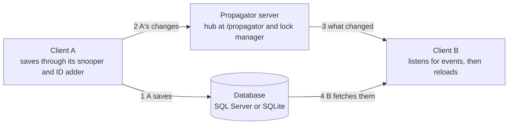

<!-- A copy of the Bold for C# User Guide doc (rev 23, 2026-11-09). The doc is the original: update this copy when the doc changes. -->

# Bold for C# User Guide

Nov 8, 2026 · @ismail özenç

## What Bold for C# is

Bold for C# turns a UML model into a running object system: you describe the classes, attributes and associations, and Bold gives you the objects, their storage and their user interface. It is the port of Bold for Delphi to .NET 10, with the same class names, the same model files and the same behaviour.

An application built on Bold writes very little plumbing:

- **Objects from the model.** Classes, attributes, associations and multiplicities come from the model, not from hand-written fields and SQL.
- **OCL everywhere.** Queries, derived members, constraints and GUI bindings are OCL expressions, and their results stay current as objects change.
- **Persistence.** Objects live in SQL Server or SQLite; Bold creates the schema, fetches objects when they are first touched and saves only what changed.
- **Typed classes when you want them.** `bold-codegen` writes a C# class for each model class; without it, every member is reached by name.
- **Handles and Bold-aware controls.** Non-visual handles hand out lists and values that follow the objects; WinForms controls show and edit them.
- **Several users.** A propagator keeps clients on one database in step, a lock manager hands out pessimistic locks, and a server can carry the persistence over HTTP.

Everything except the WinForms controls, the model editor and the propagator analyzer runs on Windows and Linux.

| Layer | Packages (`Bold.<Name>`) | What they add |
| --- | --- | --- |
| Programs | Model editor, `bold-codegen`, Propagator server, Remote server | Run them as they are; the servers also host in your own ASP.NET Core app |
| In your application | `Handles`, `WinForms` and `AwareGui`, `Propagation`, `Remote.Client` | Values that follow the objects, Bold-aware controls, multi-user clients, a database through a server |
| Extras | `SourceGenerators`, `Xmi`, `CodeGen`, `Olle` | Custom attribute types, UML tools' models, code at run time, object lending |
| **Object space** | `ObjectSpace`, `Persistence.Sql` | Systems, objects, OCL, undo and transactions; SQL Server and SQLite mapping, schema and evolution |
| Foundation | `Core`, `Model`, `ValueSpace`, `Persistence`, `Rtl` | Subscriptions, `.bld` and type names, ids and values, persistence controllers, Delphi RTL names |

Each layer uses the ones below it.

An application references a few packages from the second row; each brings the layers below it.

## Getting started

You need the .NET 10 SDK and the Bold packages, which you build from the repository with one command. Bold is not on nuget.org; you keep the packages in a folder or on your own feed.

**Requirements**

- .NET 10 SDK (the repository's `global.json` asks for 10.0.100 or a later 10.0 band).
- Windows for the WinForms controls, the model editor and the propagator analyzer; Windows or Linux for the rest.
- A database provider: `Microsoft.Data.Sqlite` for SQLite or `Microsoft.Data.SqlClient` for SQL Server.

**Get the packages**

1. Clone the repository and check out the `CSharp` branch.
2. Run `bash CSharp/deploy/check.sh`. It packs every library, the attribute generator and the `bold-codegen` tool into `CSharp/artifacts/packages`, then proves them by building a small application on them alone. On Linux it skips the Windows-only packages.
3. Or take the `packages` artifact of a CI run of the branch; each run keeps it for 14 days.
4. Make the folder a package source: `dotnet nuget add source /path/to/packages --name bold`.

To pack without the checks, run `dotnet pack CSharp/Bold.slnx -c Release`. Add `-p:Version=1.2.0` to stamp your own version; the default is 1.0.0.

**Which packages to reference**

Each package brings the ones it depends on, so an application names only the top ones.

| You want | Reference |
| --- | --- |
| Objects, OCL and undo in memory | `Bold.ObjectSpace` |
| Objects stored in SQL Server or SQLite | `Bold.Persistence.Sql` and your database provider |
| Handles: lists and values that follow the objects | `Bold.Handles` |
| Bold-aware WinForms controls | `Bold.WinForms` (Windows) |
| Several clients on one database | `Bold.Propagation` |
| A database reached through a server | `Bold.Remote.Client` |
| The propagator or remote persistence inside your own ASP.NET Core host | `Bold.Propagator.Server`, `Bold.Remote.Server` |
| Custom attribute types | `Bold.SourceGenerators` |
| XMI import and export, code generation at run time, object lending | `Bold.Xmi`, `Bold.CodeGen`, `Bold.Olle` |
| Typed classes from a model | the `bold-codegen` tool: `dotnet tool install --global bold-codegen --add-source /path/to/packages` |

The packages also bring Delphi Bold's type names, such as `TBoldRepresentation` for `int`, compiled into your project. Set `<BoldAliases>false</BoldAliases>` in your project file to leave them out.

**Build from source**

`dotnet build CSharp/Bold.slnx` builds everything, and `dotnet test CSharp/Bold.slnx` runs about 1,700 tests. `CSharp/examples` holds the Buildings and Owners application and the custom attribute example; `CSharp/README.md` maps the projects.

## A first application

This console program stores authors and books in SQLite and queries them with OCL, in about 40 lines and one model file. The package smoke test in CI (`CSharp/deploy/PackageSmoke`) takes this model through the same steps on every push.

1. Create the project and reference the packages:

```
dotnet new console -n Library
cd Library
dotnet add package Bold.Persistence.Sql
dotnet add package Bold.Handles
dotnet add package Microsoft.Data.Sqlite
```

2. Copy the model `CSharp/deploy/PackageSmoke/Library.bld` into the project folder. It has two classes, `Author` (`Name`) and `Book` (`Title`, `Year`), and the association `Authorship` between an author's `Books` and a book's `WrittenBy`. Have it copied next to the program by adding this to `Library.csproj`:

```xml
<ItemGroup>
  <None Update="Library.bld" CopyToOutputDirectory="PreserveNewest" />
</ItemGroup>
```

3. Replace `Program.cs`:

```csharp
using System.ComponentModel;
using Bold;
using Microsoft.Data.Sqlite;

bool newDatabase = !File.Exists("library.db");
using var components = new Container();

// The model
var model = new TBoldAbstractModel(components) { Name = "Library" };
var lines = new TStringList();
lines.LoadFromFile(Path.Combine(AppContext.BaseDirectory, "Library.bld"));
model.ReadModel(lines);

// The database
var connection = new TADOConnection(new SqliteConnection("Data Source=library.db"));
var adapter = new TBoldDatabaseAdapterADO(components) { Connection = connection };
adapter.SQLDatabaseConfig.InitializeDbEngineSettings(TBoldDataBaseEngine.dbeSQLite);
var database = new TBoldPersistenceHandleDB(components) { BoldModel = model, DatabaseAdapter = adapter };
if (newDatabase)
{
    database.CreateDataBaseSchema();
}

// The system: the model's objects, stored in the database
var typeInfo = new TBoldSystemTypeInfoHandle(components) { BoldModel = model, UseGeneratedCode = false };
var systemHandle = new TBoldSystemHandle(components) { SystemTypeInfoHandle = typeInfo, PersistenceHandle = database, Active = true };
TBoldSystem system = systemHandle.System!;

if (newDatabase)
{
    TBoldObject author = system.CreateNewObjectByExpressionName("Author");
    author.BoldMemberByExpressionName("name").AsString = "Ursula K. Le Guin";
    TBoldObject book = system.CreateNewObjectByExpressionName("Book");
    book.BoldMemberByExpressionName("title").AsString = "The Dispossessed";
    ((TBAInteger)book.BoldMemberByExpressionName("year")).AsInteger = 1974;
    ((TBoldObjectReference)book.BoldMemberByExpressionName("writtenBy")).BoldObject = author;
    system.UpdateDatabase();
}

Console.WriteLine(system.EvaluateExpressionAsString("Book.allInstances->size", BoldDefs.brDefault));
var titles = (TBoldList)system.EvaluateExpressionAsNewElement("Book.allInstances->orderby(year)->collect(title)")!;
for (int i = 0; i < titles.Count; i++)
{
    Console.WriteLine(titles[i]!.AsString);
}

systemHandle.Active = false;
connection.Close();
```

4. Run it with `dotnet run`. It prints `1` and `The Dispossessed`; the second run reads them back from `library.db`.

What each piece does:

- **Model component** (`TBoldAbstractModel`) holds the model read from the `.bld` file.
- **Type info handle** turns the model into run-time type information. `UseGeneratedCode = false` says there are no typed classes yet.
- **Persistence handle** maps the objects to tables. `CreateDataBaseSchema` deletes Bold's and the model's tables and creates them empty, so call it for a new database only.
- **System handle** runs the system, the object space. Objects are fetched from the database when first touched; `UpdateDatabase` saves only what changed.
- **Names**: in code and OCL, classes keep their model names (`Book`), while members start with a lowercase letter (`title`, `writtenBy`). OCL reports a capitalized member as an unknown type.

## Models

A Bold model is a UML class model: classes with attributes and methods, and associations whose two roles become members of the classes at either end. Bold reads it from a `.bld` file, its own text format, or from XMI written by a UML tool; tagged values on the elements say how Bold stores and names them.

**Where a model comes from**

- **The model editor** (`Bold.ModelEditor.exe Model.bld`, Windows) edits `.bld` files: a tree of the model, a page per kind of element, editors for tagged values, constraints and OCL, and plug-ins that validate OCL, check consistency, import and export `.bld` and XMI, and generate code and database schemas.
- **A UML tool** through XMI: Rose and UML 1.4 tools (XMI 1.x), and Enterprise Architect, MagicDraw, Papyrus and other UML 2 tools (XMI 2.x).
- **By hand**: `.bld` is plain text. Start from `Library.bld` and keep its root class and model tagged values.

**The .bld format**

Each element is a block in parentheses whose fields come in a fixed order; tagged values are one comma-separated string.

| Block | Fields, in order |
| --- | --- |
| `Model` | name, root class, stereotype, constraints, tagged values, then `Classes` and `Associations` |
| `Class` | name, superclass, persistent, abstract, stereotype, constraints, tagged values, then `Attributes` and `Methods` |
| `Attribute` | name, type, derived, stereotype, constraints, visibility (2 = public), initial value, tagged values |
| `Association` | name, link class, stereotype, constraints, tagged values, derived, then two `Role` blocks |
| `Role` | name, navigable, ordered, the class that gets the member, stereotype, multiplicity, constraints, aggregation, visibility, changeability, tagged values, `Qualifiers` |

Attribute types are `String`, `Integer`, `Float`, `Currency`, `Boolean`, `Date`, `Time`, `DateTime` and `Blob`, with the smaller integer types (`Byte`, `SmallInt`, `Word`, `ShortInt`), typed and image blobs, and the multi-language strings. Value sets and other custom types come from your own code (see Custom attribute types).

**Tagged values you will use**

| Tagged value | On | What it does |
| --- | --- | --- |
| `persistence` | class, attribute, association | `persistent` (stored) or `transient` (in memory only) |
| `Bold.TableName`, `Bold.ColumnName` | class; attribute, role | The table or column name; `<Name>` and `<Prefix>` are expanded |
| `Bold.Length` | string attribute | The column's length |
| `Bold.AllowNULL` | attribute | `True` lets the attribute be null |
| `Bold.DerivationOCL` | derived attribute or role | The OCL expression that computes it |
| `Bold.DefaultStringRepresentation` | class | An OCL expression for the object's text, shown by lists and grids |
| `Bold.Embed` | role | `True` stores a single link as a column of the class's own table |
| `Bold.DeleteAction` | role | `Allow`, `Prohibit` or `Cascade`: what deleting an object does to the objects linked to it |
| `Bold.DelayedFetch` | attribute | Fetch the value only when it is read, for large blobs |
| `Bold.UnitName` | model, class | The namespace of the generated classes |
| `Bold.FormerNames` | any element | Earlier names, so that database evolution renames instead of dropping |
| `Bold.OptimisticLocking` | model, class | `Off`, `ModifiedMembers`, `AllMembers` or `TimeStamp` |

A derived attribute has its derived field set to `TRUE` and is transient: `"persistence=Transient,Bold.DerivationOCL=items.itemSum->sum"`. Class constraints are named OCL conditions in the class's constraints field, such as `"Illegal dates=orderDate < shippingDate"`.

**XMI**

`Bold.Xmi` reads XMI and writes it back, with the tagged values:

```csharp
var link = new TBoldUMLXMILink { FileName = "Model.xmi", TranslateRoseTaggedValues = true };
TMoldModel model = link.ImportMoldModel();   // or link.ImportModel(modelComponent)
link.FileName = "Out.xmi";
link.XMIVersion = TBoldXMIVersion.xmi21;     // XMI 2.1; the default writes XMI 1.0 of UML 1.3
link.ExportModel(model);
```

An imported model is flattened and boldified: Bold adds a root class, names unnamed roles and associations, and adds link classes for many-to-many associations. State machines, use cases and diagrams are skipped. A `.bld` saved by the editor is already boldified.

## Typed classes with bold-codegen

`bold-codegen` writes a C# class for every model class, so that `book.Title` replaces `book.BoldMemberByExpressionName("title").AsString`. The system picks the classes up by itself: the type info handle's `UseGeneratedCode` is `true` unless you turn it off.

Install the tool from your packages folder, or run it from the repository:

```
dotnet tool install --global bold-codegen --add-source /path/to/packages
bold-codegen Library.bld --out Generated

dotnet run --project CSharp/tools/Bold.CodeGen.Tool -- Library.bld --out Generated
```

It writes three kinds of files into the folder:

| File | Holds | Written |
| --- | --- | --- |
| `<Class>.g.cs` | A partial class with a property per member, the typed list class (`TBookList`), and the model's methods as partial methods | Again on every run |
| `<Component>.g.cs` | The registration of the component's classes with Bold, run when the assembly loads | Again on every run |
| `<Class>.cs` | Your half of the partial class: method bodies and members derived in code | Only added to, never overwritten |

The component is the namespace: `Bold.UnitName` on the model or class, `BusinessClasses` when not set. `Library.bld` sets `LibraryClasses`. Options: `--language delphi` or `cpp` writes Delphi Bold's units instead, `--typenames <file>` adds custom attribute types, `--untyped-lists` uses `TBoldObjectList` for every list, and `--quiet` drops the log.

The first application, typed:

```csharp
using LibraryClasses;

var typeInfo = new TBoldSystemTypeInfoHandle(components) { BoldModel = model };
// ... the system handle as before ...

var author = new TAuthor(system) { Name = "Ursula K. Le Guin" };
var book = new TBook(system) { Title = "The Left Hand of Darkness", Year = 1969, WrittenBy = author };
for (int i = 0; i < author.Books.Count; i++)
{
    Console.WriteLine(author.Books[i]!.Title);
}
```

Each member also has an `M_` property for the member object itself (`book.M_Title` is the `TBAString`), which subscriptions, handles and validation work with. Setting `book.WrittenBy` adds the book to `author.Books`; Bold keeps both ends of an association in step.

A method declared in the model becomes a partial method to write in `<Class>.cs`; one tagged `Bold.OperationKind=Override` overrides a `TBoldObject` method such as `CompleteCreate`, which runs when an object is created. A member that is derived without `Bold.DerivationOCL` gets a `_<Member>_DeriveAndSubscribe` method there instead. Generate again after every model change: the type info compares the model's checksum with the one in the generated code and refuses a model that differs.

## Working with objects

Every member of an object is itself an object: an attribute (`TBAString`, `TBAInteger`, ...), a single link (`TBoldObjectReference`) or a list (`TBoldObjectList`). You change them in memory and save with `UpdateDatabase`; OCL reads them, and anything derived from them follows on its own. The snippets below use the untyped API; with generated classes, `book.Title` and `author.Books` do the same.

**Objects**

- Create: `system.CreateNewObjectByExpressionName("Book")`, or `new TBook(system)`. A class's `CompleteCreate` override runs then.
- Find: `system.ClassByExpressionName("Book")` is the list of all books; Bold fetches the objects as they are read, and `EnsureObjects()` fetches the whole list in one go. OCL finds the rest.
- Show: `obj.AsString` is the class's `Bold.DefaultStringRepresentation`.
- Delete: `obj.CanDelete()`, then `obj.Delete()`; the roles' `Bold.DeleteAction` decides whether linked objects stop it, go too, or just lose the link.

**Attributes and links**

```csharp
var year = (TBAInteger)book.BoldMemberByExpressionName("year");
year.AsInteger = 1974;
year.AsString = "1974";                       // every attribute parses its text
var writtenBy = (TBoldObjectReference)book.BoldMemberByExpressionName("writtenBy");
writtenBy.BoldObject = author;                 // a single role
var books = (TBoldObjectList)author.BoldMemberByExpressionName("books");
books.Add(otherBook);                          // a multi role: Add, Insert, Remove, Move, Includes
```

Setting either end of an association updates the other: after `books.Add(otherBook)`, `otherBook`'s `writtenBy` is the author. An attribute can be null (`IsNull`, `SetToNull()`) only when its `Bold.AllowNULL` is `True`.

**OCL**

`EvaluateExpressionAsString(ocl, BoldDefs.brDefault)` gives a result as text, `EvaluateExpressionAsNewElement(ocl)` as an element you own (cast lists to `TBoldList`), and `EvaluateExpressionAsDirectElement(ocl)` as the element itself when it exists, such as a member. Evaluate on the system for class-level expressions, or on an object, where `self` is that object.

| Expression | Gives |
| --- | --- |
| `Book.allInstances->select(year > 1950)->size` | How many books are after 1950 |
| `Book.allInstances->orderdescending(year)->first.title` | The newest book's title |
| `Book.allInstances->collect(year)->sum` | A sum over a collection |
| `Author.allInstances.books->size` | All authors' books, flattened |
| `Author.allInstances->select(name.sqlLike('%Guin'))` | A SQL-style pattern match |
| `Book.allInstances->exists(title = 'The Dispossessed')` | `Y` or `N` |
| `Book.allInstances->select(writtenBy->isEmpty)` | Books without an author |
| `year.asString + ' ' + title` (on a book) | Text built from members |

Booleans read `Y` and `N` as text in the default representation; `BoldDefs.brLong` gives `True` and `False`.

**Derived members and subscriptions**

A member with `Bold.DerivationOCL` is recomputed when what it reads changes: an author's `bookCount` (`books->size`) goes from 0 to 1 when a book is linked to her. Your own code can listen the same way:

```csharp
using var subscriber = new TBoldPassthroughSubscriber((_, _, _) => Console.WriteLine("changed"));
author.SubscribeToExpression("books->size", subscriber, false);
book.BoldMemberByExpressionName("title").AddSmallSubscription(subscriber,
    TBoldSmallEventSet.Of(BoldSubscription.beValueChanged), BoldSubscription.breReEvaluate);
```

**Constraints**

The OCL operation `constraints` lists an object's constraints as booleans that stay current:

```csharp
var constraints = (TBoldList)book.EvaluateExpressionAsNewElement("constraints")!;
for (int i = 0; i < constraints.Count; i++)
{
    var c = (TBAConstraint)constraints[i]!;
    Console.WriteLine($"{c.Constraint!.ModelName}: {c.AsBoolean}");   // Printed after 1450: False
}
```

`constraints->forAll(c | c)` says whether all of them hold. Bold does not stop you from saving an object that breaks one; check before `UpdateDatabase`, or show them in a grid.

**Saving, discarding, transactions and undo**

- `system.UpdateDatabase()` saves every changed object in one database transaction. `system.DirtyObjects` lists what is unsaved, and `obj.BoldDirty` tells for one object.
- `system.Discard()` drops what was not saved; `obj.Discard()` does it for one object.
- `system.StartTransaction()`, then `CommitTransaction()` or `RollbackTransaction()`, groups changes in memory; a rollback puts every touched object back as it was.
- Undo is off until you enable it: `system.UndoHandlerInterface.Enabled = true`. Then `SetCheckPoint()` starts a block, `UndoLatest()` takes the latest block back, and `RedoLatest()` does it again.

## Persistence

Bold stores objects in SQL Server or SQLite through ADO.NET: you give it a connection and a dialect, it creates the tables from the model, and it evolves them when the model changes. SQLite suits tests and single-user programs; SQL Server suits several users.

**SQL Server**

Create the database yourself (`CREATE DATABASE Library`); Bold creates the tables in it. The rest is the first application with another connection and dialect:

```csharp
using Microsoft.Data.SqlClient;

var connection = new TADOConnection(new SqlConnection("Server=.;Database=Library;Trusted_Connection=True;TrustServerCertificate=True"));
var adapter = new TBoldDatabaseAdapterADO(components) { Connection = connection };
adapter.SQLDatabaseConfig.InitializeDbEngineSettings(TBoldDataBaseEngine.dbeSQLServer);
var database = new TBoldPersistenceHandleDB(components) { BoldModel = model, DatabaseAdapter = adapter };
```

`TBoldDataBaseEngine` also lists Delphi Bold's other dialects (InterBase, Oracle, Informix and others). They are carried over from Delphi but only SQL Server and SQLite are tested.

**The schema**

- Each persistent class gets a table (`Bold.TableName`), each persistent attribute a column, and each single role a foreign key column when embedded. Bold adds its own tables, prefixed `BOLD_`: `BOLD_ID`, `BOLD_TYPE`, `BOLD_TABLES`, and the mapping tables.
- `database.CreateDataBaseSchema()` deletes Bold's tables and the model's, with their rows, and creates them empty. Other tables in the database stay.
- `adapter.SQLDatabaseConfig` holds the dialect's settings: column types, quoting, `SystemTablePrefix` (`BOLD` by default) and more.

**Evolving the database**

When the model changes, evolve the database instead of creating it again, with the system closed:

```csharp
var evolutor = new TBoldDataBaseEvolutor(database);
evolutor.CalculateScript();
var dbScript = new TStringList();
var mappingScript = new TStringList();
evolutor.GenerateScript(dbScript, mappingScript);   // review the SQL
var warnings = new TStringList();
evolutor.GenerateWarnings(warnings);                // columns and tables whose data will be lost
evolutor.ExecuteScript();
```

The evolutor adds and drops tables and columns and keeps the data of everything that stays. Give a renamed class or member its old name in `Bold.FormerNames`, or the evolutor drops the old column and adds an empty one. The model editor's database evolution plug-in and the WinForms `TBoldDbEvolutorForm` do the same with a review screen.

**Locking**

- Optimistic: with `Bold.OptimisticLocking` on the model, `UpdateDatabase` checks that no one changed the stored values since they were read, and fails if someone did.
- Pessimistic: a lock manager hands out locks on regions of objects before they are changed; see Multi-user.

**Without a database**

A system without a persistence handle keeps its objects in memory only, which suits tests and calculations. `TBoldPersistenceHandleFileXML` stores them in an XML file.

## Handles and the WinForms GUI

Handles are non-visual components that hand out an element or a list from an OCL expression and keep it current as objects change; Bold-aware controls show a handle's value and write edits back. You wire a form by chaining handles from the system handle and pointing controls at them, with no event code for keeping the screen up to date.

**Handles**

Handles are `System.ComponentModel` components: give each the container, and dispose the container at the end.

| Handle | Holds |
| --- | --- |
| `TBoldSystemTypeInfoHandle`, `TBoldSystemHandle` | The type information, and the running system |
| `TBoldListHandle` | A list from `RootHandle` + `Expression`, with `Count`, `List`, `CurrentIndex` and `CurrentElement`, and an optional `BoldFilter` and `BoldComparer` |
| `TBoldExpressionHandle` | One element from `RootHandle` + `Expression`, in `Value` |
| `TBoldReferenceHandle`, `TBoldVariableHandle` | An element you set, or a value of a type you name |
| `TBoldCursorHandle`, `TBoldDerivedHandle`, `TBoldFilteredHandle`, `TBoldSortedHandle`, `TBoldSQLHandle` | A cursor over a list, a value computed in code, a filtered or sorted list, and objects found with SQL |

A handle rooted in a list handle follows its current element, which makes master-detail screens:

```csharp
var authors = new TBoldListHandle(components) { RootHandle = systemHandle, Expression = "Author.allInstances" };
var books = new TBoldListHandle(components) { RootHandle = authors, Expression = "books" };   // the current author's books
```

**A WinForms window**

In a WinForms project (`net10.0-windows`, `UseWindowsForms`), reference `Bold.WinForms` as well. A grid of authors with their books, a navigator and a Save button:

```csharp
[STAThread]
static void Main()
{
    ApplicationConfiguration.Initialize();   // before the first control
    using var components = new Container();
    // ... model, database and system handle as in the first application ...
    var authors = new TBoldListHandle(components) { RootHandle = systemHandle, Expression = "Author.allInstances" };
    var books = new TBoldListHandle(components) { RootHandle = authors, Expression = "books" };

    var form = new Form { Text = "Library", Width = 640, Height = 480 };
    var bookGrid = new TBoldGrid { BoldHandle = books, BoldAutoColumns = true, Dock = DockStyle.Fill, Parent = form };
    var authorGrid = new TBoldGrid { BoldHandle = authors, Dock = DockStyle.Left, Width = 240, Parent = form };
    TBoldGridColumn name = authorGrid.Columns[1];   // a new grid has its fixed column and one empty column
    name.BoldProperties.Expression = "name";
    name.Title.Caption = "Author";
    var navigator = new TBoldNavigator { BoldHandle = authors, Dock = DockStyle.Top, Parent = form };
    var save = new Button { Text = "Save", Dock = DockStyle.Bottom, Parent = form };
    TBoldActionLink.Link(save, new TBoldUpdateDBAction(components) { BoldSystemHandle = systemHandle });
    Application.Run(form);
}
```

In a new WinForms project, `Main` sits in the project's namespace, where WinForms generates `ApplicationConfiguration`. `CSharp/deploy/WinFormsSmoke` is this window on the packages alone; CI starts it and checks that its grid shows the author.

**Controls**

- Every Bold control has `BoldHandle` and `BoldProperties`: `TBoldEdit`, `TBoldLabel`, `TBoldCheckBox`, `TBoldComboBox`, `TBoldListBox`, `TBoldGrid`, `TBoldTreeView`, `TBoldNavigator`, `TBoldMemo`, `TBoldRichEdit`, `TBoldImage`, `TBoldTrackBar`, `TBoldProgressBar` and `TBoldPageControl`.
- `BoldProperties.Expression` is the OCL the control shows, relative to the handle's current element: a `TBoldEdit` on `authors` with `Expression = "name"` edits the current author's name. `ApplyPolicy` says when edits are written back, and `Renderer` takes a renderer component that formats, colors or computes what is shown.
- A new grid has its fixed column and one empty column, which the first expression takes (`grid.Columns[1]`); `AddColumn()` adds the others, and `BoldAutoColumns = true` makes a column for each attribute of the list's class.
- `TBoldActionLink.Link(control, action)` ties a button or menu item to an action, as Delphi's `Action` property did: `TBoldUpdateDBAction`, `TBoldActivateSystemAction`, `TBoldGenerateSchemaAction`, and the list and undo actions.
- Auto forms show any object without designing a form: `BoldAFP.AutoFormProviderRegistry().FormForElement(obj)?.Show()`. A `TBoldPlaceableAFP` plugs in your own form for a class.
- Controls refresh when the application is idle, through Bold's display queue; a test without a message loop calls `TBoldQueueable.DisplayAll()`.

`Bold.AwareGui` holds the logic of these controls (followers, controllers, renderers and actions) without WinForms, so it runs and is tested on Linux; another GUI toolkit can be built on it. `CSharp/examples/Building/BldOwn` is a complete application: Delphi Bold's Buildings and Owners on WinForms and SQLite, with renderers, a filter, a comparer, drag and drop, an auto form and undo.

## Multi-user: the propagator and remote persistence

Several applications on one database stay in step through the propagator: every save is announced to the propagator server, which tells the other clients what changed, and their object spaces reload it. The same server's lock manager hands out pessimistic locks, and the remote persistence server lets clients reach the database over HTTP instead of opening it themselves.



With remote persistence, the snooper, the database and the propagator all sit in the remote server, and the clients reach it at `/persistence` and `/propagator`.

**The propagator server**

`Bold.Propagator.Server` is Delphi's enterprise propagator on ASP.NET Core, with a SignalR hub at `/propagator` where Delphi had DCOM. Start it on an address the clients can reach; Deployment shows how to run it as a service or a container:

```
dotnet Bold.Propagator.Server.dll --urls http://0.0.0.0:5050
```

Its settings are in `Bold.Propagator.Server.ini` next to the program: file logging, the thread log for the propagator analyzer, the number of sender threads, and whether unreachable clients are dropped.

**A client**

A client puts a snooper in front of its database, which tells the propagator which objects the client reads and what it saves, and on top an ID adder, which marks each request with the client's identity from its listener. The listener and its event handler bring the other clients' changes in:

```csharp
var propagator = new TBoldSignalRPropagatorHandle(components) { Url = "http://server:5050/propagator" };
var snooper = new TBoldSnooperHandle(components) { BoldModel = model, NextPersistenceHandle = database, PropagatorHandle = propagator };
var events = new TBoldExternalObjectSpaceEventHandler(components) { BoldSystemHandle = systemHandle, PropagatorHandle = propagator };
var listener = new TBoldListenerHandle(components) { PropagatorHandle = propagator, Dequeuer = events };
systemHandle.PersistenceHandle = new TBoldIDAdderHandle(components) { NextPersistenceHandle = snooper, BoldListener = listener };
propagator.Connected = true;
systemHandle.Active = true;
```

The client needs no SignalR package: the handle speaks SignalR's protocol over a WebSocket itself. When another client changed an object this one has changed too, the event handler's `OnConflict` gets the object. Without a server, `TBoldUDPModificationBroadcaster` announces changes to the other clients by UDP broadcast on the local network.

**Pessimistic locks**

Name the regions to lock in the model's `Bold.RegionDefinitions`, such as `Person[Person]: firstName, lastName, assets`, and add a lock manager handle and a locking handle:

```csharp
var lockManager = new TBoldSignalRLockManagerHandle(components) { Url = "http://server:5050/propagator" };
snooper.LockManagerHandle = lockManager;
var locking = new TBoldLockingHandle(components) { Listener = listener, LockManager = lockManager, SystemHandle = systemHandle };
lockManager.Connected = true;
```

Changing a member of a region then takes the region's lock first. Another client that changes the same region gets `EBoldGetLocksFailed`, which names the clients holding it (`ClientIds`) and the regions (`ConflictingRegions`). Saving releases the locks the client no longer needs.

**Remote persistence**

`Bold.Remote.Server` runs the persistence on a server, as Delphi Bold's SOAP persistence did: clients post their requests to `/persistence`, and with `Propagator` on, the same host runs the propagator at `/propagator`. Its `appsettings.json`:

```json
"Bold": {
  "Model": "Model.bld",
  "Provider": "Microsoft.Data.SqlClient",
  "ConnectionString": "Server=.;Database=Library;Trusted_Connection=True;TrustServerCertificate=True",
  "Engine": "dbeSQLServer",
  "CreateSchema": true,
  "Propagator": true
}
```

`Provider` is `Microsoft.Data.SqlClient` or `Microsoft.Data.Sqlite`, and `Engine` the matching `dbeSQLServer` or `dbeSQLite`. `CreateSchema` creates the tables of a database that has none of Bold's tables and leaves an existing one alone. A relative `Model` is found in the server's content root: the folder it was started from, or its own folder when it runs as a service. Start it from its own folder, or set the working directory, so that it also reads its appsettings.json there. On the client, an HTTP persistence handle takes the database handle's place, under an ID adder with a listener as above; the model must be the server's:

```csharp
var server = new TBoldHttpClientPersistenceHandle(components) { BoldModel = model, Url = "http://server:5000/persistence" };
var propagator = new TBoldSignalRPropagatorHandle(components) { Url = "http://server:5000/propagator" };
// events and listener as above
systemHandle.PersistenceHandle = new TBoldIDAdderHandle(components) { NextPersistenceHandle = server, BoldListener = listener };
```

Your own ASP.NET Core application can host both: `services.AddBoldPropagator()` with `app.MapBoldPropagator()`, and `app.MapBoldPersistence(persistenceHandle, model)`.

## Custom attribute types and object lending

New attribute types are written by a source generator from attributes on a partial class, where Delphi Bold had an IDE wizard. Object lending (OLLE) moves objects between Bold databases that do not share a server.

**Custom attribute types**

Reference the generator package; it runs when the project builds and adds nothing at run time:

```xml
<PackageReference Include="Bold.SourceGenerators" Version="1.0.0" />
```

Then declare each type as a partial class. Three kinds are possible:

```csharp
[BoldValueSet("Color", ValuePrefix = "c")]
[BoldValueSetValue("Red")]
[BoldValueSetValue("Green", "Green", "Grün")]
public partial class TBAColor : TBAValueSet { }          // enum TColorEnum, AsColor, the values

[BoldAttributeType("Point", GenerateMapper = true)]
[BoldAttributeField("X", typeof(int))]
[BoldAttributeField("Y", typeof(int))]
public partial class TBAPoint : TBoldAttribute { }       // AsX, AsY, IBoldPointContent, TBFSPoint, TBoldPMPoint

[BoldAttributeType("ShortString")]
public partial class TBAShortString : TBAString { }      // the string attribute's storage, your own rules
```

- A **value set** is an enumeration: each value has a name and string representations, the first being the default one.
- A **new attribute** has fields. With `GenerateMapper = true` it also gets a persistence mapper that stores one column per field (fields of `int`, `string`, `double`, `decimal`, `bool` or `DateTime`); the project must reference `Bold.Persistence.Sql`.
- A **subclass** of an existing attribute keeps its storage and adds your rules.

What the wizard left for you to write, you write in the same partial class: `GetStringRepresentation` and `SetStringRepresentation` for a point's text, or `ValidateString` for a short string's length. `CSharp/examples/CustomAttributes` has all three, with a model that uses them.

The model refers to a type by its model name (`Color`). Add the types to the model's type names before reading the model, and give the same names to `bold-codegen`:

```csharp
var typeNames = new TBoldTypeNameHandle(components);
TBAColor.AddTypeNameMapping(typeNames.Dictionary);
TBAPoint.AddTypeNameMapping(typeNames.Dictionary);
var model = new TBoldAbstractModel(components) { Name = "Shapes", TypeNameHandle = typeNames };
// typeNames.Dictionary.SaveToFile("Shapes.typenames") once, then: bold-codegen Shapes.bld --typenames Shapes.typenames
```

The generator reports what keeps a class from being written as BOLDGEN001 to BOLDGEN010: a class that is not partial, a wrong base class, a missing value, an unsupported field type, a duplicate name.

**Object lending (OLLE)**

OLLE lends objects from the database that owns them to another, which holds them, changes them and checks them in again. Each database keeps the state of its lending in OLLE tables of its own, and the model must use global ids, timestamps and read-only flags, as Bold's defaults do. Your application carries the value spaces between the two, by file, HTTP or any other way.

```csharp
var olleA = new TBoldOLLEHandle(components) { ApplicationPersistenceHandle = databaseA };
olleA.OLLEController.GenerateDatabase();                    // once per database: the OLLE tables

// In A, the owner: lend the objects of ids to B, which may change those of holdIds
using var lent = new TBoldFreeStandingValueSpace();
olleA.OwnObjectHandler.Get(ids, holdIds, "B", lent);         // ids and holdIds become global ids
// In B: take them in
olleB.ForeignObjectHandler.Put(lent, ids, holdIds, "A");

// Later, B checks its changes in, A takes them, B is told the new version
using var changes = new TBoldFreeStandingValueSpace();
olleB.ForeignObjectHandler.StartCheckIn(ids, releaseIds, changes, "A");
int newTimeStamp = 0;
olleA.OwnObjectHandler.CheckIn(changes, ids, releaseIds, "B", ref newTimeStamp);
olleB.ForeignObjectHandler.AcknowledgeCheckIn("A", newTimeStamp);   // or FailCheckIn("A")
```

The owner can also take objects back unchanged (`UnCheckOut`), and the two databases synchronize the objects changed since they last did (`GetSynch`, then `AcknowledgeSynch` or `FailSynch`). While B holds an object, A sees it as read-only. `tests/Bold.Olle.Tests` shows every step on two SQLite databases.

## Deployment

Bold leaves the repository as NuGet packages, as the `bold-codegen` tool, and as three programs: the two servers and the model editor. `bash CSharp/deploy/check.sh` builds all of them and proves they work outside the repository; CI runs it on every push and builds and runs the server containers.

| What | Make it with | Run or ship it |
| --- | --- | --- |
| Libraries and the attribute generator | `dotnet pack CSharp/Bold.slnx -c Release` | Push `CSharp/artifacts/packages/*.nupkg` to your feed: `dotnet nuget push *.nupkg --source <feed>` |
| `bold-codegen` | the same command | `dotnet tool install --global bold-codegen --add-source <feed>` |
| Propagator server | `dotnet publish CSharp/src/Bold.Propagator.Server -c Release -o <folder>` | A console, a Windows or systemd service, or a container |
| Remote persistence server | `dotnet publish CSharp/src/Bold.Remote.Server -c Release -o <folder>` | The same |
| Model editor | `dotnet publish CSharp/src/Bold.ModelEditor -c Release -o <folder>` | Copy the folder to Windows machines with the .NET 10 Desktop Runtime |

**Packages**

- Set the version with `-p:Version=1.2.0`; every package of one pack has the same version and depends on its siblings at that version.
- The packages carry their symbols, so a debugger steps into Bold, and the readme in `CSharp/deploy/PACKAGE.md`.
- Each CI run on the `CSharp` branch keeps its packages for 14 days as the `packages` artifact.

**Your application**

- Ship the model with the program: next to it with `CopyToOutputDirectory`, as in the first application, or embedded as a resource and read into a `TStringList` (see `BuildingModel.Lines()` in `CSharp/examples/Building/BuildingClasses`).
- Keep the connection string in configuration, not in code.
- Create the schema once, at installation, and evolve it when a new version changes the model (Persistence). Never call `CreateDataBaseSchema` on every start.
- Publish as usual: `dotnet publish -c Release`, with `-r win-x64 --self-contained` to ship .NET with the program.

**The servers as services**

Both servers run as a Windows service or a systemd service with no code change; started from a console, they behave as before. Under a service manager they read their settings from the program's folder.

```
sc.exe create BoldPropagator binPath= "C:\Bold\Propagator\Bold.Propagator.Server.exe --urls http://0.0.0.0:5050" start= auto
sc.exe start BoldPropagator
```

On Linux, `CSharp/deploy/systemd` has a unit for each server (`bold-propagator.service`, `bold-remote.service`); the comments at their tops list the commands. The remote server's unit keeps its SQLite database in `/var/lib/bold`.

**The servers in containers**

Build the images from the repository's root; they run as a non-root user and listen on port 8080:

```
docker build -f CSharp/deploy/docker/propagator.Dockerfile -t bold-propagator .
docker run -d -p 5050:8080 bold-propagator

docker build -f CSharp/deploy/docker/remote.Dockerfile -t bold-remote .
docker run -d -p 5000:8080 -v "$PWD/Model.bld:/model/Model.bld:ro" -v bold-data:/data bold-remote
```

The remote image reads the model from `/model/Model.bld` and keeps a SQLite database in the `/data` volume, whose tables it creates the first time. For SQL Server, set `Bold__Provider`, `Bold__Engine` and `Bold__ConnectionString` with `-e`.

**Configuration**

| Setting | Where |
| --- | --- |
| Address and port | `--urls http://0.0.0.0:5050`, or `ASPNETCORE_URLS`; containers listen on `ASPNETCORE_HTTP_PORTS` (8080) |
| Remote persistence: `Model`, `Provider`, `ConnectionString`, `Engine`, `CreateSchema`, `Propagator` | The `Bold` section of `appsettings.json`, or environment variables such as `Bold__ConnectionString`, which take precedence |
| Propagator: logging, the analyzer's thread log, sender threads, dropping unreachable clients | `Bold.Propagator.Server.ini` next to the program; the remote server's built-in propagator reads `Bold.Remote.Server.ini` |
| Health checks | `GET /health` answers `Healthy` on both servers |

**Security**

The servers do not authenticate their clients: anyone who reaches `/propagator` or `/persistence` can use them. Run them on a private network or VPN, or behind a reverse proxy with TLS that limits who may connect; clients take `https://` addresses. In your own ASP.NET Core host, `MapBoldPersistence` and `MapBoldPropagator` return endpoint builders, so `.RequireAuthorization()` protects them; the HTTP persistence handle takes your own `HttpClient` (with credentials) through its `HttpClient` property, while the propagator handle has no credentials yet.

## Coming from Delphi Bold

Code written for Delphi Bold reads almost the same in C#: the classes keep their names (`TBoldSystem`, `TBAString`, `TBoldListHandle`), models are the same `.bld` files, and OCL and tagged values are unchanged. What changed is how objects are made and freed, and the parts that were tied to Delphi, COM and the IDE.

| Delphi Bold | Bold for C# |
| --- | --- |
| `TPerson.Create(BoldSystem)` | `new TPerson(system)` |
| `Free`, `destructor Destroy` | `Dispose()`; components go in a `Container` |
| Components on a form or data module (`.dfm`) | Components made in code, or by the WinForms designer; `BeginInit` and `EndInit` stand in for loading |
| Unit-level routines and constants | Members of a static class named after the unit: `BoldDefs.brDefault` |
| Type aliases such as `TBoldRepresentation = integer` | Global using aliases, brought by the packages |
| `set of T` | `DelphiSet<T>`, with `+`, `-`, `*`, `<=` and `>=` |
| `procedure ... of object` events | Delegates with the same parameter names |
| `TStringList` and other RTL classes Bold uses | The same names in `Bold.Rtl` |
| VCL Bold controls | WinForms controls of the same names, with `BoldHandle` and `BoldProperties` |
| Generated `BusinessClasses.pas` and `.inc` files | `<Class>.g.cs` and your `<Class>.cs`; `bold-codegen --language delphi` still writes the Delphi units |
| The attribute wizard in the IDE | The `Bold.SourceGenerators` source generator |
| The model editor in the IDE | `Bold.ModelEditor`, a standalone Windows program |
| BDE, IBX, dbExpress and ADO components | ADO.NET connections in `TADOConnection`, with SQL Server and SQLite dialects |
| DCOM propagator and lock manager | The same server on ASP.NET Core, with a SignalR hub |
| SOAP and HTTP persistence | `Bold.Remote.Server` and `Bold.Remote.Client` |
| XMI 1.x link | The same, plus XMI 2 import and export |

**Not ported**

COM and DCOM distribution (the COM object space and type libraries), CLX and Kylix, the Rational Rose COM link (use XMI, which reads Rose's tagged values), the ModelMaker link and the ECO III generator, the IDE's design-time packages as IDE code (their logic is ported), the dead database drivers, the propagator's own forms, and Delphi Bold's examples, which are replaced by `CSharp/examples`. `CSharp/docs/DROP_LIST.md` lists every dropped item with its reason.

**Finding a Delphi name**

Search the C# sources for the Delphi name; it is the same. Every C# file starts with the path of the Delphi unit it ports, every ported element carries a `[Delphi(PortStatus...)]` attribute, and `CSharp/port/units/<Unit>.md` lists each symbol of a unit with links to its Delphi line, its C# code and its tests. All 383 units planned for the port are ported; CI's port status shows how many of their symbols tests cover (66% today).

## Troubleshooting

Most problems show up as a system that will not start or an OCL error; both come with a message that names the cause. When a system will not activate, read `typeInfo.StaticSystemTypeInfo!.InitializationLog.Text`, which lists every problem the model has.

| What you see | Why | What to do |
| --- | --- | --- |
| `Year is not a typename (but it is a member of the current class context, use lowercase!)` | OCL takes a capitalized name for a class | Write members with a lowercase first letter: `year`, `writtenBy` |
| `Generated code for Book not registered with framework` | `UseGeneratedCode` is on, but no generated classes are compiled in | Add the `bold-codegen` output to the project, or set `UseGeneratedCode = false` |
| `Generated CRC differs from Model CRC ... Please regenerate code.` | The model changed after the classes were generated | Run `bold-codegen` again |
| `Unable to find Mapping for Shape.Color: Color` | The model uses a type Bold does not know | Add the custom types to the type name handle before the model is read (Custom attribute types) |
| Missing tables or columns when saving | The database is older than the model | Evolve it with `TBoldDataBaseEvolutor`; create it only when it is new |
| Data gone after a restart | `CreateDataBaseSchema` ran on an existing database | Call it for new databases only; the remote server's `CreateSchema` already checks |
| An OCL result list loses items while you delete | Lists from OCL drop deleted objects | Copy the list first, or walk it from the end |
| `SetCompatibleTextRenderingDefault must be called before the first IWin32Window object is created` | A control was made before `ApplicationConfiguration.Initialize()` | Call it first in `Main`, then make handles, forms and controls |
| Bold controls do not refresh in a test | Followers display when the application is idle, and a test has no message loop | Call `TBoldQueueable.DisplayAll()` |
| `The registered .NET Data Provider's DbProviderFactory ... couldn't be loaded` | The remote server was published without its SQL providers (an offline build) | Publish it normally; `check.sh` starts the published server to catch this |
| `Bold:Model names ..., which does not exist` | A relative model path is taken from the folder the server was started from (its own folder when it runs as a service) | Put the model there, or give an absolute path |
| Other clients do not see changes | A link in the client chain is missing, or the hub cannot be reached | Check the snooper, ID adder and listener, connect the propagator handle before activating the system, and ask the server for `/health` |
| `EBoldGetLocksFailed` | Another client holds the region's lock | Its `ClientIds` names the holder; wait for it to save, or tell the user |
| A tagged value with spaces or commas breaks a hand-edited `.bld` | Tagged values are one comma-separated string | Quote the whole item: `\"Bold.DerivationOCL=qty * part.price\"` |

For anything else, the tests are the most complete examples of the API: `CSharp/tests` has a project per library, laid out like the sources.
